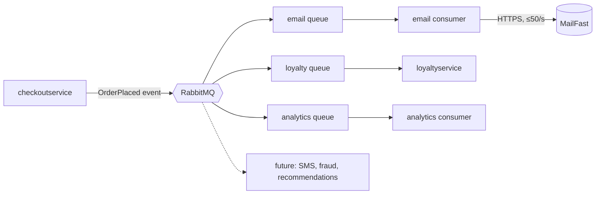

# ADR-0002: Publish an "order placed" event to RabbitMQ for post-order actions

- **Status:** Accepted
- **Date:** 2026-10-21
- **Deciders:** Ashira Aungsumal

## Context and problem

Requirement R-12 adds three post-order actions: confirmation email through **MailFast**, loyalty points through a new `loyaltyservice`, and an "order placed" analytics event. Marketing expects more next year (SMS, fraud scoring, a recommendations update).

Today `checkoutservice.PlaceOrder` runs payment, shipping, empty cart and then `sendOrderConfirmation` in sequence, over gRPC, inside the request (`system/online-boutique/src/checkoutservice/main.go`, lines 252-279). An email failure is only logged with `log.Warnf` and the order still succeeds (lines 273-277). `checkoutservice` holds one address and one connection per downstream service (`emailSvcAddr`/`emailSvcConn`, lines 81-82, wired in `main()` with `mustMapEnv`/`mustConnGRPC`, lines 115, 122). Adding the three actions the same way adds three more addresses, connections and calls to `PlaceOrder`; every future action would mean editing and redeploying `checkoutservice`.

Facts from the scenario that constrain the decision:

| Topic | Fact |
|---|---|
| Checkout latency | p95 of `PlaceOrder` ≤ 500 ms |
| Peak load | 200 orders/s (11.11 sale) |
| MailFast | p95 1.5 s, p99 8 s, about 0.5 % failures, rate limit 50 emails/s |
| Loyalty | within 1 minute of the order, exactly once |
| Availability | an order must never fail because email, loyalty or analytics is down |
| Team / ops | 4 developers, strong in Go and gRPC, two have used RabbitMQ; Kubernetes; prefer open-source, self-hosted |

## Decision drivers

1. **Availability:** an order never fails because email, loyalty or analytics is down.
2. **Performance:** `PlaceOrder` p95 stays ≤ 500 ms at 200 orders/s, although MailFast p95 is 1.5 s.
3. **Correctness:** loyalty points exactly once, within 1 minute.
4. **Modifiability:** SMS, fraud scoring and recommendations can be added next year without changing `checkoutservice`.
5. **Fit with team and operations:** Go/gRPC skills, RabbitMQ experience on the team, open-source and self-hosted on Kubernetes.
6. **Cost / operability:** as few new moving parts as justified.

## Considered options

1. Extend synchronous gRPC fan-out in `checkoutservice` (call `emailservice`/MailFast, `loyaltyservice` and an analytics service in `PlaceOrder`)
2. Same fan-out, but asynchronous inside `checkoutservice` (goroutines, in-memory retry)
3. Publish an `OrderPlaced` event to a self-hosted **RabbitMQ** broker; each action is an independent consumer with its own queue
4. Publish to a managed cloud queue/topic (e.g. a cloud pub/sub service)

### Pros and cons of the options

| Option | Pros | Cons |
|---|---|---|
| 1. Synchronous gRPC fan-out | Same pattern as today; team knows Go and gRPC; no new infrastructure | MailFast p95 1.5 s / p99 8 s breaks the 500 ms p95 budget if awaited; 0.5 % MailFast failures and any downstream outage must be swallowed by hand in each call; MailFast 50/s limit cannot be honoured at 200 orders/s; each new action edits `checkoutservice` (modifiability) |
| 2. In-process async fan-out | No new infrastructure; request latency is protected | Pending work is lost when the `checkoutservice` pod restarts, so loyalty "exactly once within 1 minute" cannot be guaranteed; no shared rate limiter across replicas for the 50/s limit; still couples `checkoutservice` to every new action |
| 3. RabbitMQ event + consumers | Checkout only publishes one event, so latency is independent of MailFast; durable queues survive consumer outages (availability); queue buffers the 200/s peak and the email consumer drains at ≤ 50/s; one queue per consumer lets SMS, fraud scoring and recommendations be added without touching `checkoutservice`; open-source, self-hostable on Kubernetes; two developers have used it | New stateful component to run and monitor; at-least-once delivery means consumers must be idempotent; eventual consistency (email and points arrive after the response); the publish step itself can fail |
| 4. Managed cloud queue | No broker to operate; scales on demand | Cloud-specific, conflicts with the preference for open-source self-hosted components; no team experience given; cost not given |

## Decision

Use option 3. After payment and shipping succeed, `checkoutservice` publishes one `OrderPlaced` event (order ID, user, email, items, totals) to **RabbitMQ**, deployed in-cluster on Kubernetes. Each post-order action is a separate consumer with its own durable queue:

- **email consumer** (replaces the mock `emailservice` logic): calls MailFast, with a rate limit of 50 emails/s shared across replicas (e.g. one consumer with bounded prefetch), retries with backoff, and a dead-letter queue for failures;
- **`loyaltyservice`** (new): awards points; idempotent on `order_id` (a uniqueness check on the key in its own store) so a redelivered message never gives double points;
- **analytics consumer**: records the event for marketing.

## Consequences

- **Positive:** `PlaceOrder` latency no longer depends on MailFast, loyalty or analytics; it adds only one publish (performance).
- **Positive:** a down consumer or MailFast outage leaves messages queued rather than failing orders (availability).
- **Positive:** the queue absorbs the 200 orders/s peak and lets the email consumer respect 50 emails/s (performance, availability).
- **Positive:** new actions are new consumers; `checkoutservice` and existing consumers are unchanged (modifiability).
- **Positive:** open-source, self-hosted, and partly known to the team (cost, operability).
- **Negative:** one more stateful component to deploy, secure and monitor (operability, cost).
- **Negative:** email and points arrive after the order response, not within it; the user may see "order placed" before the email (consistency).
- **Negative:** consumers must handle duplicates and poison messages (correctness, development effort).
- **Risks and mitigations:**
  - *Event lost if publish fails or the broker is down at checkout.* This means no email, no points, which breaks "exactly once, within 1 minute". Mitigate with publisher confirms and a short retry. A transactional outbox would be stronger but needs `checkoutservice` to have its own store, which it does not show today (not evidenced in `main.go`).
  - *RabbitMQ is a single point of failure.* Mitigate with a clustered deployment and durable, replicated queues.
  - *Email backlog during the peak.* At 200 orders/s against 50/s the queue grows by about 150 messages/s for as long as the peak lasts. Mitigate by alerting on queue depth; the email delay limit is an open question.
  - *Duplicate points.* Mitigate with an idempotency key on `order_id` and a test that redelivers the same message.

## Validation

- Load test `PlaceOrder` at 200 orders/s with the Locust `loadgenerator`, a stubbed MailFast with p95 1.5 s / p99 8 s and 0.5 % failures. Check that p95 of `PlaceOrder` is ≤ 500 ms.
- Failure tests: stop RabbitMQ, each consumer and the MailFast stub in turn. Check that no order fails.
- Redeliver and replay the same `OrderPlaced` event to `loyaltyservice`. Check that points are awarded once.
- Measure the delay between order and points (must be < 1 minute at peak) and the email queue depth over a simulated 11.11 peak.
- Review after the first post-order action (e.g. SMS) is added: was `checkoutservice` left unchanged?
