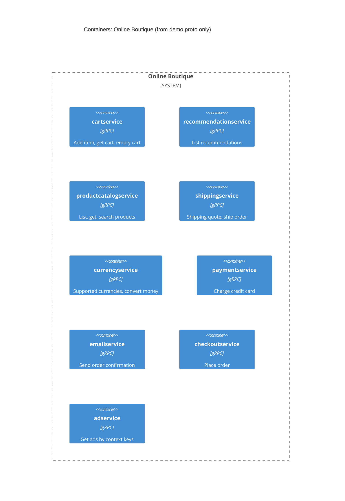

# 1A – Recovered architecture (run A)

## 1. Agent

Claude Code (Anthropic CLI), model `anthropic/claude-sonnet-5-5`.

## 2. Files read

- `prompts/1-recover-architecture.md` (task file)
- `AGENTS.md` (repository rules)
- `system/online-boutique/protos/demo.proto` (the only evidence)

## 3. Containers table

The proto defines gRPC service interfaces (`package hipstershop`). Each `service` is treated as one container. The proto says nothing about implementation language, so that column is "Not evidenced".

| Name | Technology / language | Responsibility | Evidence |
|---|---|---|---|
| cartservice | gRPC service; language not evidenced in the provided files | Add item, get cart, empty cart per `user_id` | `system/online-boutique/protos/demo.proto` (`service CartService`: `AddItem`, `GetCart`, `EmptyCart`) |
| recommendationservice | gRPC service; language not evidenced | Returns recommended product IDs | `demo.proto` (`service RecommendationService`: `ListRecommendations`) |
| productcatalogservice | gRPC service; language not evidenced | List, get and search products | `demo.proto` (`service ProductCatalogService`: `ListProducts`, `GetProduct`, `SearchProducts`) |
| shippingservice | gRPC service; language not evidenced | Shipping quote and ship order (returns tracking ID) | `demo.proto` (`service ShippingService`: `GetQuote`, `ShipOrder`) |
| currencyservice | gRPC service; language not evidenced | List supported currencies, convert `Money` | `demo.proto` (`service CurrencyService`: `GetSupportedCurrencies`, `Convert`) |
| paymentservice | gRPC service; language not evidenced | Charge a credit card, returns `transaction_id` | `demo.proto` (`service PaymentService`: `Charge`) |
| emailservice | gRPC service; language not evidenced | Send order confirmation email | `demo.proto` (`service EmailService`: `SendOrderConfirmation`) |
| checkoutservice | gRPC service; language not evidenced | Place order (`PlaceOrder`) | `demo.proto` (`service CheckoutService`: `PlaceOrder`) |
| adservice | gRPC service; language not evidenced | Return ads for context keywords | `demo.proto` (`service AdService`: `GetAds`) |

Not evidenced in the provided files: any frontend, any data store, any message broker.

## 4. Dependencies table

Not evidenced in the provided files. A `.proto` file defines each service's interface (the callee side). It does not show who calls whom. No caller → callee pair can be proven, so the table is empty.

| Caller → callee | Protocol | Evidence |
|---|---|---|
| *(none provable)* | – | – |

## 5. Mermaid diagram

The diagram matches the tables: nine containers, no `Rel`. The end-user `Person` and external systems are omitted because the evidence does not show them (see Gaps).

## 6. Gaps

| Gap | Extra file that would settle it |
|---|---|
| Who calls each service. **[Inferred]** only: `PlaceOrderRequest`/`OrderResult` reuse `Address`, `CreditCardInfo`, `Money`, `CartItem`, and `SendOrderConfirmationRequest` carries `OrderResult`. That hints `checkoutservice` may orchestrate cart, catalog, currency, shipping, payment and email. A message type is not a call, so it is not in the diagram. | `system/online-boutique/kubernetes-manifests/checkoutservice.yaml` (`*_SERVICE_ADDR` env vars) or `src/checkoutservice/main.go` |
| Whether a frontend or end user exists, and how users reach the system | `kubernetes-manifests/frontend.yaml`, or `src/frontend/` |
| Implementation language per service (only `option go_package` appears, and it applies to generated stubs, not to services) | Each service's `Dockerfile` or source folder |
| Any data store (e.g. where `cartservice` keeps carts) | `kubernetes-manifests/cartservice.yaml` and the cart service config |
| Message broker or async channel | Kubernetes manifests, or the checkout/email source |
| External systems (e.g. payment provider, email/SMTP, ad network) | Service source and manifests |
| Ports, deployment units, and whether each service is a separate container | `kubernetes-manifests/*.yaml` |
| `recommendationservice` relies on product data? Not shown | `src/recommendationservice/` source |
