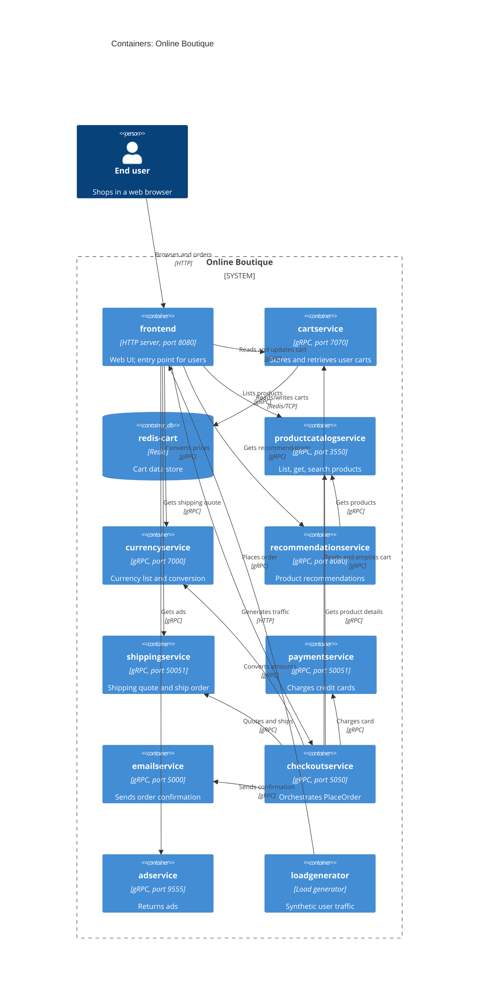

# 1B – Recovered architecture (C4 containers)

## 1. Agent

Claude Code (Anthropic CLI), model `claude-sonnet-5-5`.

## 2. Files read

- `prompts/1-recover-architecture.md`
- `AGENTS.md`
- `system/online-boutique/protos/demo.proto`
- `system/online-boutique/kubernetes-manifests/` (directory listing)
- `system/online-boutique/kubernetes-manifests/adservice.yaml`
- `system/online-boutique/kubernetes-manifests/cartservice.yaml`
- `system/online-boutique/kubernetes-manifests/checkoutservice.yaml`
- `system/online-boutique/kubernetes-manifests/currencyservice.yaml`
- `system/online-boutique/kubernetes-manifests/emailservice.yaml`
- `system/online-boutique/kubernetes-manifests/frontend.yaml`
- `system/online-boutique/kubernetes-manifests/kustomization.yaml`
- `system/online-boutique/kubernetes-manifests/loadgenerator.yaml`
- `system/online-boutique/kubernetes-manifests/paymentservice.yaml`
- `system/online-boutique/kubernetes-manifests/productcatalogservice.yaml`
- `system/online-boutique/kubernetes-manifests/recommendationservice.yaml`
- `system/online-boutique/kubernetes-manifests/shippingservice.yaml`
- `system/online-boutique/kubernetes-manifests/README.md`

## 3. Containers

Implementation languages are not evidenced in these files (only image names), so the technology column states what is evidenced.

| Name | Technology / language | Responsibility | Evidence |
|---|---|---|---|
| frontend | HTTP server on 8080 (language not evidenced); exposed via `LoadBalancer` Service `frontend-external` | Web UI; the only container with an external entry point; calls all backend services | `kubernetes-manifests/frontend.yaml` (`containerPort: 8080`, `frontend-external` `type: LoadBalancer`) |
| cartservice | gRPC on 7070 (language not evidenced) | Add item, get and empty a user's cart | `kubernetes-manifests/cartservice.yaml` (`containerPort: 7070`, `REDIS_ADDR`); `protos/demo.proto` (`service CartService`) |
| redis-cart | Redis (`redis:alpine`), `emptyDir` volume at `/data` | Cart data store | `kubernetes-manifests/cartservice.yaml` (Deployment `redis-cart`, `image: redis:alpine`, `volumes: redis-data emptyDir`) |
| productcatalogservice | gRPC on 3550 | List, get and search products | `kubernetes-manifests/productcatalogservice.yaml` (`PORT=3550`); `protos/demo.proto` (`service ProductCatalogService`) |
| currencyservice | gRPC on 7000 | Supported currencies, currency conversion | `kubernetes-manifests/currencyservice.yaml` (`PORT=7000`); `protos/demo.proto` (`service CurrencyService`) |
| recommendationservice | gRPC on 8080 | Product recommendations (`ListRecommendations`) | `kubernetes-manifests/recommendationservice.yaml` (`PORT=8080`); `protos/demo.proto` (`service RecommendationService`) |
| shippingservice | gRPC on 50051 | Shipping quote and ship order | `kubernetes-manifests/shippingservice.yaml` (`PORT=50051`); `protos/demo.proto` (`service ShippingService`) |
| paymentservice | gRPC on 50051 | Charge a credit card (`Charge`) | `kubernetes-manifests/paymentservice.yaml` (`PORT=50051`); `protos/demo.proto` (`service PaymentService`) |
| emailservice | gRPC; Service port 5000 → container 8080 | Send order-confirmation email | `kubernetes-manifests/emailservice.yaml` (`port: 5000`, `targetPort: 8080`); `protos/demo.proto` (`service EmailService`) |
| checkoutservice | gRPC on 5050 | Orchestrates `PlaceOrder` | `kubernetes-manifests/checkoutservice.yaml` (`PORT=5050`); `protos/demo.proto` (`service CheckoutService`) |
| adservice | gRPC on 9555 | Returns ads (`GetAds`) | `kubernetes-manifests/adservice.yaml` (`PORT=9555`); `protos/demo.proto` (`service AdService`) |
| loadgenerator | Load generator, config `USERS`, `RATE`, `FRONTEND_ADDR` (tool not evidenced) | Synthetic user traffic against frontend. Present as a manifest but commented out of `kustomization.yaml` | `kubernetes-manifests/loadgenerator.yaml`; `kubernetes-manifests/kustomization.yaml` line 24 |

## 4. Dependencies

Protocol "gRPC" is inferred from the `grpc:` probes and the `service` definitions in `demo.proto`; the `*_ADDR` variables show who calls whom.

| Caller → Callee | Protocol | Evidence |
|---|---|---|
| End user → frontend | HTTP | `frontend.yaml` (`frontend-external` LoadBalancer, port 80 → 8080; `httpGet /_healthz`) |
| loadgenerator → frontend | HTTP | `loadgenerator.yaml` (`FRONTEND_ADDR=frontend:80`, `wget http://${FRONTEND_ADDR}`) |
| frontend → productcatalogservice | gRPC | `frontend.yaml` (`PRODUCT_CATALOG_SERVICE_ADDR=productcatalogservice:3550`) |
| frontend → currencyservice | gRPC | `frontend.yaml` (`CURRENCY_SERVICE_ADDR=currencyservice:7000`) |
| frontend → cartservice | gRPC | `frontend.yaml` (`CART_SERVICE_ADDR=cartservice:7070`) |
| frontend → recommendationservice | gRPC | `frontend.yaml` (`RECOMMENDATION_SERVICE_ADDR=recommendationservice:8080`) |
| frontend → shippingservice | gRPC | `frontend.yaml` (`SHIPPING_SERVICE_ADDR=shippingservice:50051`) |
| frontend → checkoutservice | gRPC | `frontend.yaml` (`CHECKOUT_SERVICE_ADDR=checkoutservice:5050`) |
| frontend → adservice | gRPC | `frontend.yaml` (`AD_SERVICE_ADDR=adservice:9555`) |
| checkoutservice → productcatalogservice | gRPC | `checkoutservice.yaml` (`PRODUCT_CATALOG_SERVICE_ADDR`) |
| checkoutservice → shippingservice | gRPC | `checkoutservice.yaml` (`SHIPPING_SERVICE_ADDR=shippingservice:50051`) |
| checkoutservice → paymentservice | gRPC | `checkoutservice.yaml` (`PAYMENT_SERVICE_ADDR=paymentservice:50051`) |
| checkoutservice → emailservice | gRPC | `checkoutservice.yaml` (`EMAIL_SERVICE_ADDR=emailservice:5000`) |
| checkoutservice → currencyservice | gRPC | `checkoutservice.yaml` (`CURRENCY_SERVICE_ADDR=currencyservice:7000`) |
| checkoutservice → cartservice | gRPC | `checkoutservice.yaml` (`CART_SERVICE_ADDR=cartservice:7070`) |
| recommendationservice → productcatalogservice | gRPC | `recommendationservice.yaml` (`PRODUCT_CATALOG_SERVICE_ADDR=productcatalogservice:3550`) |
| cartservice → redis-cart | Redis protocol over TCP | `cartservice.yaml` (`REDIS_ADDR=redis-cart:6379`; Service port `tcp-redis`) |

## 5. Diagram

## 6. Gaps

| Gap | Extra file that would settle it |
|---|---|
| `frontend.yaml` sets `SHOPPING_ASSISTANT_SERVICE_ADDR=shoppingassistantservice:80`, but no such manifest is in the evidence and it is not in `kustomization.yaml`. Existence, protocol and purpose are not evidenced, so it is not in the diagram. | `kustomize/components/shopping-assistant/` or the release manifests |
| `frontend.yaml` has a commented-out `PACKAGING_SERVICE_URL` (optional "packaging service"). Not evidenced as a deployed container. | Frontend source, or release manifests |
| Implementation languages of every service. | Each service's source directory (`src/*/`) or Dockerfile |
| Whether any service calls an external system (e.g. real payment, SMTP, ad network). None appears in the evidence, so no `System_Ext` is drawn. | Source of `paymentservice`, `emailservice`, `adservice` |
| Whether `loadgenerator` is part of the deployed system: manifest exists but is commented out in `kustomization.yaml` (a dev-time skaffold module). Drawn because its manifest shows a runtime dependency on frontend. | `skaffold.yaml` |
| `kustomization.yaml` lists optional components (`memorystore`, `alloydb`, `spanner`, `google-cloud-operations`, `network-policies`) commented out. They may replace/add data stores or external systems in other deployments; not evidenced here. | `kustomize/components/*` |
| `kubernetes-manifests/README.md` says the manifests are not directly deployable (images are inserted by `skaffold`); real image/tech details are in `/release`. | `release/kubernetes-manifests.yaml` |
| `demo.proto` shows the RPC contracts but not which service calls which; the call graph here comes only from `*_ADDR` variables. Whether each configured address is actually used at runtime is not proven. Also, `adservice` has no `*_ADDR` variables, so it has no evidenced outbound calls. | Service source code |
| `productcatalogservice`, `currencyservice`, `shippingservice`, `paymentservice`, `emailservice`, `adservice` show no data store in manifests; whether they keep one (e.g. product data) is not evidenced. | Service source code |
