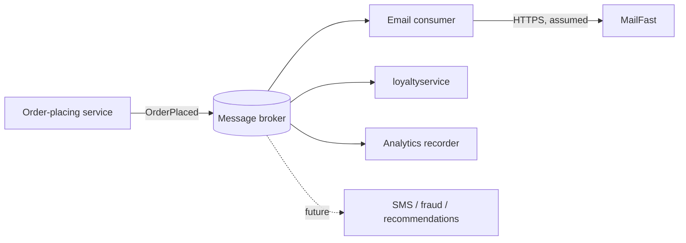

Agent: Claude Code, model anthropic/claude-sonnet-5-5. Run a (zero-shot, context: none). Written from the requirement text and `docs/adr/template.md` only. No system files were read.

# ADR-0002: Publish an "order placed" event to a message broker and let post-order consumers subscribe

- **Status:** Proposed
- **Date:** 2026-10-21
- **Deciders:** Not given (see Open questions)

## Context and problem

After an order is placed, Online Boutique must do three things:

1. Send the confirmation email through **MailFast**, a new external email provider. This replaces the mock `emailservice` logic.
2. Award loyalty points through a new `loyaltyservice`, which has to be built.
3. Record an "order placed" analytics event for the marketing team.

Marketing expects more post-order actions next year: SMS, fraud scoring, and a recommendations update.

The decision is how the order-placing flow triggers these actions. Three concerns follow from the requirement:

- **Coupling.** If the order-placing service calls each consumer directly, it must change every time a consumer is added. The requirement says there will be at least three more.
- **Failure isolation.** MailFast is an external system outside our control. `loyaltyservice` is new and unproven. A failure in either must not make an already-paid order fail or hang.
- **Semantics differ per action.** Email and loyalty points must not be lost, and loyalty points must not be awarded twice. A lost analytics event is probably more tolerable. Fraud scoring may need to run before fulfilment, which would make it synchronous. That cannot be confirmed from the requirement.

Facts about the current system (how the order is orchestrated today, which protocols are used, whether a broker exists) were not provided and are not assumed here.

## Decision drivers

1. **Modifiability:** adding SMS, fraud scoring or a recommendations update next year should not require changing the order-placing code.
2. **Availability / fault isolation:** a MailFast outage or a `loyaltyservice` failure must not block or fail order placement.
3. **Reliability of delivery:** the email and the loyalty points must eventually happen, and exactly once in effect (idempotent).
4. **Performance (customer-facing latency):** checkout response time should not grow with each added post-order action.
5. **Cost and operational complexity:** the team must be able to run whatever is introduced. Team skills are not given (see Open questions).
6. **Testability / replaceability:** the external provider (MailFast) should be swappable behind a boundary we own.

## Considered options

1. **Synchronous orchestration:** the order-placing service calls the email service, `loyaltyservice` and an analytics endpoint directly, one after another, over request/response.
2. **Event-driven publish/subscribe:** the order-placing service publishes one `OrderPlaced` event to a message broker. Email, loyalty and analytics are independent subscribers, and future actions subscribe without changes upstream.
3. **Asynchronous fire-and-forget calls without a broker:** the order-placing service calls the consumers directly but does not wait for them (background threads or tasks, in-process retry).

### Pros and cons of the options

| Option | Pros | Cons |
|---|---|---|
| 1. Synchronous orchestration | Simplest to build and debug. No new infrastructure. Results are immediately known. Suits any action that must block the order (e.g. fraud scoring, if required). | The order-placing service must change for each new action (modifiability). Order latency is the sum of all calls, including the external MailFast call (performance). Any consumer failure or timeout can fail or stall checkout (availability). Needs per-call retry logic in the caller. |
| 2. Event-driven pub/sub | Adding SMS, fraud scoring or recommendations means adding a subscriber, with no change to the publisher (modifiability). Consumers fail and retry independently (availability). Checkout latency does not depend on consumers (performance). The broker can buffer during a MailFast outage (reliability). | Adds a new component to run, monitor and secure (cost, operability). Eventual consistency: the customer may see "order placed" before the email is sent. Needs idempotent consumers and a dead-letter strategy. Harder end-to-end tracing. The publish itself can fail after the order is saved, so a transactional-outbox style guarantee may be needed. |
| 3. Async calls without a broker | No new infrastructure. Checkout is not blocked by consumers. | The caller still knows every consumer, so it changes for each new action (modifiability). Pending work is lost if the process crashes (reliability). Retry and back-pressure must be hand-built in each caller. |

## Decision

Choose **Option 2: event-driven publish/subscribe.** The order-placing flow publishes a single `OrderPlaced` event after the order is committed. Three consumers subscribe:

- an email consumer that sends through MailFast;
- the new `loyaltyservice`;
- an analytics recorder.

Why:

- It is the only option that satisfies both of the top drivers: new actions can be added without touching the publisher, and an external failure cannot fail the order.
- Option 1 is cheaper now, but the requirement itself says the list will grow, so its coupling cost recurs with every new action.
- Option 3 removes the blocking but keeps the coupling, and adds a loss risk.

Conditions and boundaries:

- The MailFast integration sits behind the email consumer. The rest of the system never calls MailFast directly (driver 6).
- Consumers must be idempotent, keyed by order ID, so redelivery does not double-award points or send duplicate emails.
- If fraud scoring turns out to be a pre-fulfilment gate, it is not a good fit for this event path. It would need a synchronous call in the order flow. This decision does not cover that case. Revisit it when the requirement is defined.

## Consequences

- **Positive:** New post-order actions are added as subscribers with no publisher change. (modifiability)
- **Positive:** A MailFast outage or a `loyaltyservice` bug does not fail or delay checkout. (availability, performance)
- **Positive:** Buffered events let email and points catch up after an outage. (reliability)
- **Positive:** MailFast can be replaced by changing only the email consumer. (modifiability)
- **Negative:** A new infrastructure component must be chosen, run and monitored. (cost, operability)
- **Negative:** Eventual consistency. The customer may be told the order succeeded before the email or points exist. (consistency, user-perceived behaviour)
- **Negative:** Debugging a flow across services is harder. (testability, observability)
- **Risks and mitigations:**

| Risk | Mitigation |
|---|---|
| Order is saved but the event is never published | Transactional outbox, or publish with retry and reconciliation (needs a decision on the order store) |
| Duplicate delivery causes double points or double emails | Idempotency key on order ID in every consumer |
| Poison message blocks a consumer | Retry limit and dead-letter queue, with an alert |
| Broker becomes a single point of failure | Run it highly available. Choice and sizing are open (see Open questions) |
| Event schema drifts as consumers are added | Versioned event schema, with additive changes only |
| Personal data in the event (email address, name) reaches analytics | Keep the event minimal and let each consumer fetch what it needs. Confirm the data-protection rules (open question) |

## Validation

- **Failure test:** make MailFast unavailable (stub returning errors) and confirm that checkout success rate and latency are unchanged, and that emails are sent after recovery.
- **Idempotency test:** redeliver the same `OrderPlaced` event and confirm exactly one email and one points award.
- **Extensibility check:** add a dummy fourth subscriber and confirm that no change is needed in the publishing service.
- **Metrics:** event publish success rate, consumer lag, dead-letter count, and p95 checkout latency before and after. Targets are not given (see Open questions).
- **Review date:** revisit when the first of SMS, fraud scoring or the recommendations update is specified, especially if any of them must block the order.

## Open questions

- What does the current order flow look like (who orchestrates, which protocols, is there any broker already)? This ADR assumes nothing about it.
- Is there an existing message broker or cloud messaging service, and which does the team know how to operate? Team skills are not given.
- Who are the deciders and stakeholders (marketing, loyalty owner, operations)?
- What are the non-functional targets? Checkout latency budget, order volume, acceptable email delay, and availability goal are all unspecified.
- Must email and loyalty points be exactly-once, or is at-least-once with idempotency acceptable?
- Is analytics loss acceptable, or must every event be recorded?
- Is fraud scoring a blocking pre-fulfilment check? If so, it needs a synchronous path.
- What are MailFast's API, rate limits, SLA, pricing and authentication? Nothing about it is given.
- What loyalty rules apply (points per order, expiry, refunds or cancellations that reverse points), and where does `loyaltyservice` store its data?
- What data may go to the analytics destination (personal data, consent, retention)?
- Where does the analytics event go (an existing tool, a warehouse, something new)?
- What deployment environment and budget constrain the broker choice?
